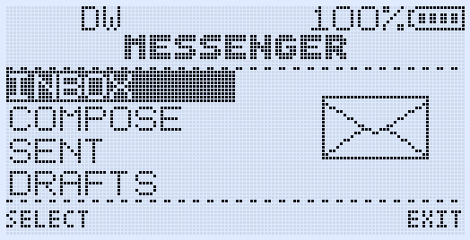
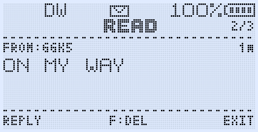
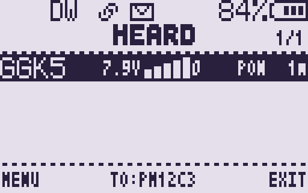

# KLEANFW

**Field-ready firmware for the Quansheng UV-K1 / UV-K5 V3: radio-to-radio
text, hopping voice inversion and a firmware that goes easy on its own flash.**

[](https://github.com/AislanJefferson/KLEANFW/releases/latest)
[](https://github.com/AislanJefferson/KLEANFW/releases)
[](LICENSE)

> [!IMPORTANT]
> Only for UV-K1 / UV-K5 V3 radios with the **PY32F071 MCU and BK4829 RF chip**.
> Never flash it on UV-K5 V1/V2 or other BK4819 radios. KLEANFW is an
> independent project; read the [Legal notices](#legal-notices) before you
> flash it or transmit with it.

## Why KLEANFW

KLEANFW is aimed at small groups that carry the same radio: a team on a trail,
a club net or a family on a trip. When several people run the same firmware,
the radios can exchange short texts, confirm who is in range and, where the
rules allow it, keep casual listeners from following the conversation.

It starts from [GOGUFW 3.6.2](https://github.com/Gogu-Qs/GOGUFW-UV-K1-Messenger)
by Gogu-Qs, itself built on Armel's F4HWN firmware. KLEANFW then takes its own
direction:

- **Shared key, shared group.** One passphrase (CryKey) drives both the voice
  hopping and the message encryption.
- **Flash that lasts.** The SPI flash is erased far less often, so settings
  saves, Messenger traffic and tuning do not wear it out.
- **Safe defaults.** Transmit is limited to Brazil's general-use channels until
  you change F Lock, and fresh channels start in Narrow.
- **Room for fixes.** Rarely used features were moved out of the build so that
  bug fixes still fit the 118 KiB program flash.

## Highlights

**Talk**
- **HOP voice scrambler.** The inversion carrier changes every 500 ms in a
  sequence derived from the CryKey. A short data burst at each PTT keeps
  receivers in step, and late listeners catch up within 8 s.
- **Fixed scrambler** (2600–3500 Hz) for radios that only know classic
  inversion. Both scramblers work on FM only.
- **CALLTX.** Five call melodies sent over the air with F+9.

**Text**
- **Messenger.** 36-character messages with delivery receipts, retries,
  a 16-message Inbox, 8 sent messages and 8 reusable drafts. It listens in the
  background on any screen.
- **CryKey encryption.** With a passphrase set, the message text is sent
  XTEA-CTR encrypted. Radios without the same key simply never see it.
- **HEARD, Range Check and Auto Check.** See who answered, with battery voltage
  and signal strength, on demand or every 30 s to 10 min.

**Listen and scan**
- **Spectrum.** Sweep a frequency range, or only the channels of the current
  channel's scan list, then listen to a peak or jump straight to its saved
  channel.
- **Scanning** with an RSSI trail, scan-list switching on the fly and Full
  Watch over up to four channels.
- **Broadcast FM** with 48 named memories, through two small overlay apps.

**Built to last**
- Deferred flash erases, Messenger IDs reserved 64 at a time, and no
  calibration-sector writes on mute.
- **F Lock**: BRASIL (default), DISABLE ALL or UNLOCK ALL.
- **Multiboot** with up to five firmware images and separate settings banks,
  plus 48 slots for overlay apps (APRS, SSTV, tools, games).

| Messenger home | Reading a message | Range Check answer |
| --- | --- | --- |
|  |  |  |

## Get started

1. **Check the radio.** UV-K1 or UV-K5 V3 with PY32F071 + BK4829 only.
2. **Back up.** Save a full CHIRP image, including calibration, and keep a DFU
   recovery image at hand.
3. **Download** the files from the
   [latest release](https://github.com/AislanJefferson/KLEANFW/releases/latest):

   | File | What it is for |
   | --- | --- |
   | `KLEANFW-v0.2.0.bin` | The firmware |
   | `KLEANFW-v0.2.0-multiboot.bin` | The same image, named for a multiboot slot |
   | `KLEANFW_0.2.0_chirp_module.py` | CHIRP module for this version |
   | `FM-Search-Apps.zip` | `FMVFO.app`, `FMMemory.app` and `Search.app` |
   | `Apps.zip` | Every other overlay app (Beam is not supported) |
   | `SHA256SUMS.txt` | Checksums to verify the downloads |

4. **Flash** the firmware with your usual tool (UV Studio, DFU, k5prog).
5. **Install the apps.** With the radio running, use the **Apps** page of
   UV Studio. Broadcast FM needs both `FMVFO.app` and `FMMemory.app`; F+4 and
   F+STAR need `Search.app`.
6. **Load the CHIRP module.** Use **File → Load Module**, then pick the model
   **Quansheng → UV-K1 / UV-K5 V3 KLEANFW**. Modules from GOGUFW or other
   versions can overwrite fields: do not use them.

> [!NOTE]
> On the first boot after an update, the firmware clears the keypad and menu
> locks, the side-key setup and display inversion, and turns `SetRxG` back ON.
> Channels and calibration stay as they were.

## Keys you will use

| To do this | Press |
| --- | --- |
| Open Messenger | **F + MENU** |
| See who is in range (HEARD, PING, Auto Check) | **F + 7** |
| Send a call melody | **F + 9** |
| Open the spectrum analyser | **F + 5** |
| Broadcast FM (needs the FM apps) | **F + 0** |
| Search a frequency / a CTCSS-DCS tone (needs `Search.app`) | **F + 4** / **F + STAR** |
| Backlight: always on → always off → normal | **F + 8** |
| Lock or unlock the keypad | Hold **F** |
| Pick a firmware slot | Hold **MENU** while switching on |
| Turn the channel scrambler on or off | Side key set to **SCRAMBLE** |
| Spectrum: next scan list (MR) / listen bandwidth | **4** / **6** |
| Spectrum: ignore this peak / backlight cycle | **SIDE1** / **SIDE2** |

## HOP and CryKey in 60 seconds

On **every** radio of the group:

1. **MENU → Msg → CryKey**: type the same passphrase, up to 10 characters
   (case sensitive).
2. On the channel you will use: **Channels → Scramb = HOP**, FM modulation.
3. Keep **MsgRx ON** and **VOX OFF**, and do not scan while you listen.

After pressing PTT, wait a moment before talking, because the first quarter of
a second carries the sync burst. A soft tick every half second on receive is
normal.

With a CryKey set, message **text** is encrypted. Callsigns, message IDs,
receipts, PING/PONG and battery voltage still go out in clear, and there is no
message authentication. An empty CryKey means plain-text messages and a common
default HOP sequence.

> [!WARNING]
> HOP is spectrum inversion with a changing carrier, not encryption, and the
> Messenger encryption is not authenticated. Neither is meant for real
> security. Both are **forbidden on amateur bands** and restricted on many
> other services. See [Legal notices](#legal-notices).

## Coming from GOGUFW

- **Messenger** still talks to GOGUFW radios in plain text. Encrypted text only
  works between KLEANFW radios with the same CryKey; GOGUFW rejects it.
- **CHIRP** needs `KLEANFW_0.2.0_chirp_module.py`. Over USB, CHIRP and UV Studio
  read the host identity `v7 GGFW v6.3.0`, which UV Studio uses to choose the
  app catalog. The radio itself, SystemInfo and multiboot show
  `KLEANFW v0.2.0`.
- **Apps** use the same official F4HWN API 4 as GOGUFW 3.6.x, so your
  installed apps keep working. The CryKey of the old `Crypto.app` test builds
  must be typed again in the menu.
- **Left out of this build** to make room: K5Viewer, Audio Scope, RF Log Lite,
  resume-after-power-off, the scan progress bar, and the PMR, GMRS/FRS/MURS
  and CA transmit plans.

Everything that changed is listed in the [CHANGELOG](CHANGELOG.md).

## Documentation

The full user manual is in Portuguese: [MANUAL.md](MANUAL.md). Good places to
start:

- [Every menu item](MANUAL.md#6-menu): what it does, its options and default
- [Messenger](MANUAL.md#9-messenger) and [CryKey](MANUAL.md#11-criptografia-crykey)
- [Voice scrambler, fixed and HOP](MANUAL.md#12-scrambler-de-voz-fixo-e-hop)
- [Spectrum](MANUAL.md#17-spectrum) and [CHIRP](MANUAL.md#25-chirp)
- [Troubleshooting](MANUAL.md#28-solução-de-problemas) and
  [legal notices](MANUAL.md#30-avisos-legais-e-licenças)

Release notes: [docs/releases/v0.2.0.md](docs/releases/v0.2.0.md).

## Build

With Docker installed:

```bash
./compile-with-docker.sh   # firmware only -> build/Fusion/kleanfw.bin
./build-all.sh             # firmware + all apps + CHIRP module check -> build/dist/
```

A native build needs CMake, Ninja and `arm-none-eabi-gcc`:

```bash
cmake --preset Fusion --fresh
cmake --build --preset Fusion
```

The image must stay within **120,832 bytes**, including the 920-byte
multiboot loader. Release 0.2.0 uses 120,464 bytes, leaving 368 bytes free, so
every change is measured. Setup guides:
[BUILD_WITH_VSCODE.md](BUILD_WITH_VSCODE.md) (Docker) and
[BUILD_VSCODE_MAC.md](BUILD_VSCODE_MAC.md) (native, macOS).

## Status and feedback

0.2.0 is the second KLEANFW release. Open questions, such as STE on strong
repeaters and HOP timing under heavy load, are listed under *Known issues* in
the [CHANGELOG](CHANGELOG.md). Report bugs in
[GitHub Issues](https://github.com/AislanJefferson/KLEANFW/issues) with the
firmware version, the channel settings and the steps to reproduce.

## Credits and license

KLEANFW is not a clean-room firmware. It is a modified version of GOGUFW, which
builds on several generations of Quansheng community work. The attribution
below describes the parts that directly reached this project or served as a
documented design reference.

| Project / contributor | Contribution used by KLEANFW |
| --- | --- |
| [Gogu-Qs / GOGUFW](https://github.com/Gogu-Qs/GOGUFW-UV-K1-Messenger) | The direct base of KLEANFW (GOGUFW 3.6.2): Messenger, HEARD, multi-radio Range Check, wake/ACK/PONG reliability work, the CALLTX feature and melodies, FM names and Live RSSI, channel policies, the fixed per-channel scrambler integration, UI adaptations and CHIRP integration. CALLTX uses the inherited low-level tone/TX audio path, but its feature design, melodies, selection/preview behavior and user interface are GOGUFW work. RF Log Lite was inspired by Armel's RF Log and independently reimplemented as a smaller 20-entry RAM-only version for GOGUFW. |
| [Dual Tachyon](https://github.com/DualTachyon/uv-k5-firmware) | Original open UV-K5 firmware foundation, hardware drivers and AirCopy/FSK plumbing that the Messenger RF layer adapts on the BK4829 platform. |
| [OneOfEleven](https://github.com/OneOfEleven/uv-k5-firmware-custom) | Core custom-radio work inherited through the firmware lineage, including the AM-fix, scrambler and low-level radio foundations. |
| [fagci](https://github.com/fagci/uv-k5-firmware-fagci-mod) | Original Spectrum Analyzer implementation inherited and further adapted through egzumer, F4HWN, GOGUFW and KLEANFW. |
| [egzumer](https://github.com/egzumer/uv-k5-firmware-custom) | The custom-firmware base that brought together the OneOfEleven modifications, fagci Spectrum and the broader extended radio feature set. |
| [Armel / F4HWN](https://github.com/armel/uv-k1-k5v3-firmware-custom) | The Fusion base of GOGUFW, including the UV-K1/UV-K5 V3 integration, radio/UI improvements, menu categories, Action Picker, official multiboot implementation, overlay app ABI and UV Studio, and the original RF Log feature. |
| [muzkr](https://github.com/muzkr/uv-k1-k5v3-firmware-custom) | Joint UV-K1/UV-K5 V3 PY32F071 port, board support, drivers and external SPI-flash/settings work used by the current platform. |
| [mrkusypl](https://github.com/mrkusypl/uv-k1-k5v3-firmware-custom) and [Tunas1337](https://github.com/Tunas1337) | Upstream optimization, FM/UI/Spectrum and hardware-support work incorporated through the F4HWN base. |
| [joaquimorg](https://github.com/joaquimorg/UV-KX-firmware) and [Kamil / NUNU](https://github.com/kamilsss655/uv-k5-firmware-custom) | Earlier UV-K5 radio-to-radio Messenger work that helped establish the feature and provided comparison material. NUNU's manual Spectrum behavior also served as a reference while correcting GOGUFW's manual mode. |
| [Jacek Lipkowski SQ5BPF](https://github.com/sq5bpf/uvk5-reverse-engineering), EGZUMER, JOC2 and F4HWN | The Quansheng UV-K5 CHIRP driver and its adaptations, from which the KLEANFW CHIRP module is derived. |
| [AislanJefferson](https://github.com/AislanJefferson) | KLEANFW: HOP voice scrambler, CryKey and encrypted Messenger text, Spectrum rework, flash-wear reduction, F Lock BRASIL, menu-category integration, the fixes listed in the CHANGELOG and the user manual. |

GOGUFW also thanks [lohtse](https://github.com/lohtse),
[mkalin22](https://github.com/mkalin22), Konstantin Leibovitch and
[Robby69](https://github.com/robby69), as well as the other community members
who supplied reproducible real-radio reports, build-configuration feedback and
regression testing for Messenger, Range Check, Spectrum, FM and radio safety.

**Licenses.** The firmware is distributed under the
[Apache License 2.0](LICENSE). Copyright and license headers already present in
individual source files remain in force; files changed by KLEANFW carry a
"Modified by AislanJefferson for KLEANFW" notice and files added by KLEANFW
carry their own header. The [NOTICE](NOTICE) file must be kept with any
redistribution. The CHIRP module (`KLEANFW_*_chirp_module.py`) is licensed
under the GNU GPL v2 or later ([LICENSE-GPL-2.0.txt](LICENSE-GPL-2.0.txt)).
Bundled third-party components keep their own licenses: Arm CMSIS
(Apache-2.0), CherryUSB (Apache-2.0) and mpaland's embedded printf (MIT).

## Legal notices

- **No warranty.** KLEANFW is provided "AS IS", without warranties or
  conditions of any kind, and the authors are not liable for any damage
  (Apache License 2.0, sections 7 and 8). Flashing custom firmware can brick
  the radio or erase its calibration. Back up the radio and its calibration
  first, and keep a DFU recovery image.
- **No affiliation.** KLEANFW is an independent project, not affiliated with,
  sponsored by or endorsed by Gogu-Qs, Armel / F4HWN, Quansheng or any other
  project named here. Quansheng, UV-K1 and UV-K5 are trademarks of their
  owners; GOGUFW is the name of the Gogu-Qs project. These names are used only
  to describe the code's origin and the supported hardware.
- **Radio regulations.** You are responsible for complying with the licensing,
  frequency, power, emission and equipment-certification rules of your
  country. Modified firmware can void the type approval (for example Anatel
  homologation) of the radio. `F Lock = UNLOCK ALL` allows TX outside the
  frequencies you may be authorised to use.
- **Scrambler and encryption.** Transmissions encoded to obscure their meaning
  are prohibited in the amateur service by national rules in most countries
  (for example FCC 47 CFR §97.113(a)(4) in the USA) and, between countries,
  by the ITU Radio Regulations (Article 25.2A). They are restricted on many
  other services too. Use the scrambler, HOP and CryKey only where they are allowed.
  None of them provides security: HOP is a hopping spectrum inversion, and
  the Messenger encryption has no authentication.
- **Cryptography.** The firmware contains cryptographic software (XTEA). Check
  the laws of your country on using, importing and exporting it.
