# KLEANFW 0.1.0

KLEANFW is a custom firmware for the Quansheng UV-K1 / UV-K5 V3. It is a
modified version of **[GOGUFW 3.6.2](https://github.com/Gogu-Qs/GOGUFW-UV-K1-Messenger)
by Gogu-Qs**, which is based on **F4HWN 6.3.0** with selected F4HWN 7.0
services. KLEANFW keeps the GOGUFW Messenger, HEARD, Range Check, CALLTX and
FM features and adds the HOP voice scrambler, encrypted Messenger text
(CryKey), a reworked Spectrum, lower SPI flash wear and a set of fixes.

> [!IMPORTANT]
> KLEANFW is an independent project. It is **not affiliated with or endorsed
> by** Gogu-Qs, Armel / F4HWN, Quansheng or any other project credited below.
> Read the [Legal notices](#legal-notices) before flashing or transmitting.

## Firmware at a glance

| Statistic | Project status |
| --- | --- |
| 📦 **Current release** | KLEANFW 0.1.0 (radio identity `KLEANFW v0.1.0`) |
| ⬇️ **Release downloads** | [](https://github.com/AislanJefferson/KLEANFW/releases) |
| ⭐ **GitHub stars** | [](https://github.com/AislanJefferson/KLEANFW/stargazers) |
| 🧩 **Firmware base** | GOGUFW 3.6.2 → F4HWN 6.3.0 + selected F4HWN 7.0 additions |
| 📻 **Supported radios** | Quansheng UV-K1 / UV-K5 V3 |
| ⚙️ **Hardware** | PY32F071 MCU · BK4829 RF IC |
| 🛠️ **Build preset** | Fusion · Release · ARM GNU Embedded |
| 💾 **Firmware image** | 120,772 / 120,832 bytes · **99.95%** · 60 bytes free, including the 920-byte multiboot load image |
| ✉️ **Tools** | Messenger (optional XTEA-CTR text) · HEARD · Auto Check · Range Check · CALLTX · Full Watch · FM names/RSSI |
| 🔀 **Voice scrambler** | Fixed carriers 2600–3500 Hz and HOP (carrier changes every 500 ms), FM only |
| 🔌 **CHIRP support** | Matching 0.1.0 module with 1024 memories, Messenger settings, CryKey, HOP, F Lock, FM names and all channel policies |

## Compatibility and downloads

KLEANFW is intended only for Quansheng **UV-K1 / UV-K5 V3** radios built around
the **PY32F071 MCU and BK4829 RF IC**. Do not install it on UV-K5 V1/V2 or other
BK4819-based radios.

[Download KLEANFW releases](https://github.com/AislanJefferson/KLEANFW/releases)

Release 0.1.0 contains:

- `KLEANFW-v0.1.0.bin` and `KLEANFW-v0.1.0-multiboot.bin`: normal and multiboot
  firmware images (same image, multiboot file name);
- `KLEANFW_0.1.0_chirp_module.py`: the matching custom CHIRP module;
- `FMVFO.app` and `FMMemory.app`: the two required Broadcast FM overlays;
- `Search.app`: the Frequency/Tone Search overlay used by F+4 and F+STAR;
- `Apps.zip`: every overlay app built from this source tree.

**Broadcast FM is not a resident screen. Install both `FMVFO.app` and
`FMMemory.app`; installing only one leaves mode switching incomplete. Install
`Search.app` for F+4/F+STAR.**

Overlay apps use F4HWN's official ABI 1 / API 4 layout, as in GOGUFW 3.6.x.
Apps built for the old experimental GOGUFW API 4–9 are rejected as
incompatible. The `Crypto.app` of earlier development builds is no longer
used: the CryKey is a menu item now.

> [!NOTE]
> **First boot after flashing:** the version changes, so the firmware runs its
> one-time version reset: keypad lock, menu lock, SET_KEY and display
> inversion (SET_INV) are cleared, `SetRxG` is turned back ON, and invalid
> boot-logo lines or erased dBm corrections are repaired. Channels,
> calibration and the other settings are kept. If you used the CryKey of an
> older development build through `Crypto.app`, enter it again in
> **MENU → Msg → CryKey**.

Back up the radio with CHIRP before updating and keep a known-good DFU recovery
image available. The complete user manual (Portuguese) is in
[MANUAL.md](MANUAL.md). See [CHANGELOG.md](CHANGELOG.md) for the list of
changes.

## Differences from GOGUFW 3.6.2

**Added**

- **HOP voice scrambler** (Scramb = HOP): the inversion carrier changes every
  500 ms over 16 carriers chosen per bandwidth, following the shared CryKey.
  A short FSK seed burst starts every PTT and resyncs receivers every 8 s.
  HOP is not encryption.
- **CryKey** (MENU → Msg → CryKey, up to 10 characters, also editable in
  CHIRP): with a passphrase set, Messenger text is sent XTEA-CTR encrypted.
- **SCRAMBLE** side-key action (toggles the channel scrambler, HOP by default).
- **Menu categories** from F4HWN, with an `Msg` category for Messenger settings.
- **Spectrum**: MR mode sweeps the active scan list (key 4 changes it), shows
  the channel modulation/bandwidth like VFO, key 6 bandwidth persists for all
  channels until EXIT, PTT×2 opens the matching MR channel or lands in the VFO
  like a typed frequency, backlight follows `BLTime`, and SIDE2 runs the F+8
  backlight cycle.

**Changed**

- **Less SPI flash wear**: sector erases are deferred and committed once,
  Messenger IDs are reserved in blocks of 64, mute no longer writes the
  calibration sector, and a menu change is committed on the next idle tick.
- **F Lock** offers only BRASIL (Anatel general-use channels, default),
  DISABLE ALL and UNLOCK ALL.
- Default bandwidth for fresh channels and VFOs is Narrow (12.5 kHz).
- Typing a VFO frequency starts a clean simplex setting (tones, offset and
  reverse cleared).
- The fixed and HOP scramblers work only on FM, on TX and RX.
- Boot goes straight to the radio (the `POnMsg` welcome option was removed).

**Removed from the Fusion build** (to fit the flash): K5Viewer, Audio Scope,
RF Log Lite, Resume State, Scan Progress bar, the PMR/GMRS/FRS/MURS/CA TX plans
and `Crypto.app`. The source of the disabled features stays in the tree behind
their build flags.

**Fixed** (selection): USB serial replies HardFaulted the radio (UV Studio and
CHIRP over USB froze it), Spectrum hangs and wrong listen filters, AM register
values without `ENABLE_FEAT_F4HWN_AUDIO`, LNA/PGA gain leaking out of Spectrum,
UI overlaps (TX lock vs CALLTX, scan-range tone line, FM pointer). See the
[CHANGELOG](CHANGELOG.md) for details.

## Main features

### Messenger

Messenger sends and receives short text messages directly between compatible KLEANFW and GOGUFW radios over FSK (encrypted text needs KLEANFW and the same CryKey on both sides). It works as a sidecar to normal analog operation, so receiving messages does not require leaving the Messenger screen open.

New messages use a distinct monophonic classic-phone alert measured from the
requested Nokia reference: four equal 932 Hz, 200 ms notes in two close pairs,
with a longer pause between the pairs. ACK uses the same short single
confirmation chirp as a manual PONG instead of the message rhythm. Both still
follow the Messenger `MsgBeep` setting.

- 36-character messages with T9-style text entry;
- 16-message Inbox, 8-message Sent list and 8 editable quick-message Drafts;
- delivery acknowledgements, retry status and up to three responding callsigns;
- Reply, Resend and Delete controls;
- duplicate-message protection;
- a shared `CllSgn` station callsign used by Messenger and compatible APRS TX/Beacon apps, plus receive, ACK, alert-beep and LED settings;
- a short wake frame before the first normal message attempt to improve reception while the destination radio is idle;
- per-channel **No FSK TX** protection for channels where Messenger transmission must remain disabled;
- TX-frequency, F Lock, modulation and channel-policy checks before every message, retry, ACK, PING or PONG;
- a clear TX-blocked popup that identifies No FSK, frequency, modulation, configuration or battery restrictions.

Open Messenger with **F + MENU**, or assign **MESSENGER** to a side key. The assigned Messenger action is a toggle: use it again on the Messenger home screen to return to the radio.

| Messenger hub | Messaging preferences |
| --- | --- |
|  | 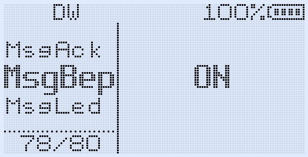 |

| New message editor | Message ready to send |
| --- | --- |
| 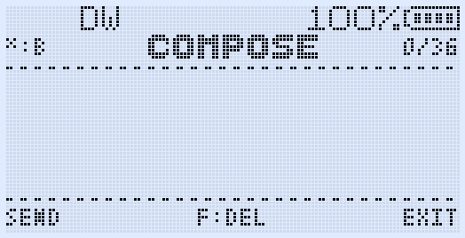 | 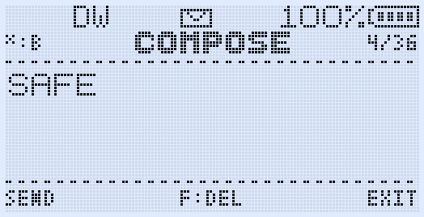 |

| Quick-message drafts | Received message view |
| --- | --- |
| 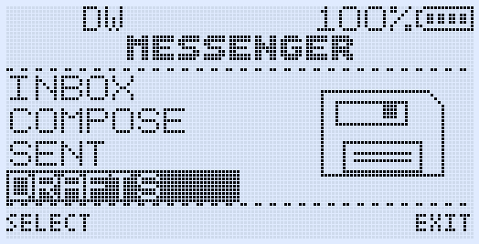 |  |

| Delivery overview | Sent message details |
| --- | --- |
| 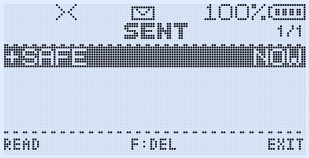 | 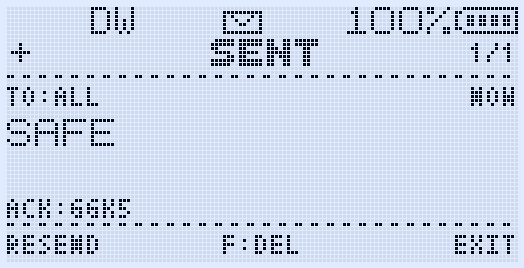 |

#### Messenger controls

| Screen | Controls |
| --- | --- |
| Home | **UP/DOWN** selects Inbox, Compose, Sent or Drafts; **MENU** opens; **EXIT** returns to the radio. |
| Inbox / Sent | Four visible rows; **UP/DOWN** selects; **MENU** reads; **F** deletes; **EXIT** returns. Inbox rows show unread state, sender, preview and age; Sent rows show delivery state, preview and age. |
| Read | **UP/DOWN** changes message; **MENU** replies or resends; **F** deletes; **EXIT** returns. |
| Compose / Draft edit | Number keys enter text; hold a number for the digit; **STAR** cycles `B`/`b`/`2`; **F** deletes; **MENU** sends; **EXIT** returns. |

### HEARD and Range Check

HEARD records recently received Messenger packets with callsign, battery voltage when available, RSSI bar and numeric RSSI, packet type and age. Range Check now runs directly inside the same list instead of opening a separate result view.

- Open HEARD with **F + 7**, or assign **HEARD** to a side key.
- Press **MENU** on HEARD to open **SEND PING** and **AUTO CHECK**. SEND PING starts the normal 12-second Range Check.
- If a manual or automatic PING is blocked by channel/frequency/modulation or
  battery policy, the same visible TX-blocked warning and dedicated short/long
  error tone are produced. A blocked automatic attempt also cancels AUTO CHECK
  instead of appearing to remain active.
- AUTO CHECK offers **OFF**, **30 seconds, 1 minute, 5 minutes and 10 minutes** and can repeat the check on every normal firmware screen. A received PONG updates HEARD silently; a cycle with no replies gives a restrained 450-to-320 Hz descending two-tone immediately from the background service rather than waiting for a key press. Active voice TX/RX and scanning defer the check until the RF path is free.
- Selecting a timed AUTO CHECK sends the first PING immediately. Its VOX status-bar slot remains empty until that first result is known. A chain-link icon stays fixed after a PONG; the same icon blinks at one-second intervals if the 12-second reply window expires unanswered. Later checks keep the last completed result visible until a new result replaces it. If VOX is enabled, the VOX icon takes priority and the AUTO CHECK mark is hidden.
- The Messenger envelope is independent of AUTO CHECK: it appears only while at least one Inbox message is unread and clears immediately after the last unread message is read or deleted.
- Existing MSG, ACK, PNG and PON rows remain visible during the check. Each responding station is moved to the top with its voltage and RSSI details.
- Each row uses four separated groups: station ID with voltage, RSSI bar with numeric RSSI, packet type, and age. Voltage, numeric RSSI, packet type and age use a compact font aligned to the bottom of the normal-font station ID.
- Use **UP/DOWN** to move through entries and **EXIT** to return to the radio.
- `RngRsp` controls automatic PONG replies.
- Randomized ACK and PONG timing reduces collisions when several radios answer together.

The assigned HEARD action also behaves as a toggle.

| AUTO CHECK status on the radio screen | HEARD activity and PONG result |
| --- | --- |
| 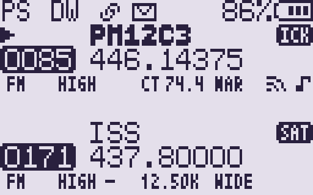 |  |

| HEARD action menu | AUTO CHECK interval selection |
| --- | --- |
| 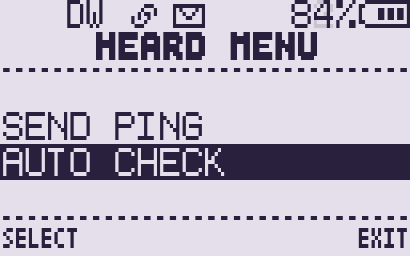 | 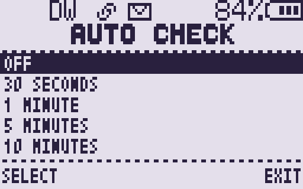 |

### Encrypted Messenger text (CryKey)

Set a shared passphrase in **MENU → Msg → CryKey** (up to 10 characters, case
sensitive) or in CHIRP. With a CryKey, the text of every Messenger message is
sent XTEA-CTR encrypted with a random salt per message. The sender callsign,
message ID, ACK, PING, PONG and WAKE packets stay in clear, and there is no
message authentication (MAC). Radios with a different or empty CryKey drop the
encrypted message silently; GOGUFW radios reject the packet type. An empty
CryKey keeps Messenger text in clear.

### Voice scrambler (fixed and HOP)

Set the scrambler per channel in **Channels → Scramb**, with the **SCRAMBLE**
side-key action or in CHIRP. A double-wave icon on the VFO line shows that it
is on. Both scramblers work only on FM.

- **Fixed** (2600–3500 Hz): spectrum inversion with a fixed carrier; both radios
  must use the same carrier.
- **HOP**: each PTT sends a ~0.25 s FSK seed burst (wait a moment before
  talking), then the carrier changes every 500 ms (N/N+: 2600–3100 Hz, Wide:
  2900–3400 Hz) in a sequence derived from the CryKey. A resync burst every 8 s
  lets late receivers join. The receiver needs Scramb = HOP, `MsgRx` ON, VOX
  OFF, the same CryKey and no scan.

> [!WARNING]
> Scrambling and encryption are **not allowed on amateur radio** and are
> restricted on many other services. HOP only defeats quick decoding with a
> fixed-inversion scrambler; it is not secure. See [Legal notices](#legal-notices).

### Scanning

KLEANFW uses the F4HWN scan interface without the progress bar:

- An RSSI sparkline of the last scanned steps is drawn on the scanning VFO line in normal and fast scan.
- **F + UP/DOWN** or two number keys (`00` = ALL, `01`–`24`) change the scan list while scanning; the status bar shows the active list (`ALL`, the list name or number, `+` when priority scanning is on).
- Hold **MENU** on a stopped channel or frequency to exclude it from the scan. Scanning continues immediately. Memory-channel exclusions last until the radio is switched off.

### Menu categories

**MENU** opens a category screen (Channels, Scan, Keys, Power, Display, Timers, Audio, Radio, DTMF, Msg and All). **UP/DOWN** selects a category, **MENU** opens it and **EXIT** goes back to the categories. Each category remembers its last position. **All** is the complete flat list with the original order and numbers; typing a number on the category screen jumps straight to that item in All. The status bar shows `MENU` or the open category. Service (hidden menu) appears only after an F-LOCK boot. Every menu item (what it does, its options, default and when to change it) is explained in [MANUAL.md, section 6](MANUAL.md#6-menu).

### TX frequency lock (F Lock)

`F Lock`, in the hidden menu (Service category), has three options:

- **BRASIL**: TX only on the Brazilian license-free general-use radio channels of Anatel Ato 14448 (Tabela XII): 462.5625–462.7125 MHz and 467.5625–467.7125 MHz. This is the default.
- **DISABLE ALL**: no TX on any frequency.
- **UNLOCK ALL**: TX on every supported band (confirm three times). Licensed amateurs need this option for 2 m and 70 cm.

The firmware does not limit TX power, and the general-use rule is written for
certified radios: check that your use is allowed. UNLOCK ALL lets the radio
transmit on frequencies you may not be authorised to use.

### CALLTX

CALLTX transmits one of five selectable alert melodies using the existing radio TX path.

- **F + 9** transmits the selected melody.
- `CllTon` selects the melody and provides a preview.
- `CllVol` selects low or high tone-generator level.
- The melody completes its current phrase without clipping the final note.
- CALLTX does not append the normal Roger beep or MDC tail.
- Assign **CALLTX** to a side key for direct access.

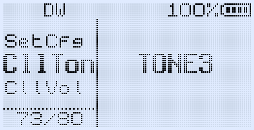

### FM broadcast radio

The BK1080 driver and storage bridge stay resident, but the interface runs
from two required overlays. Install both `FMVFO.app` and
`FMMemory.app` from UV Studio's **Apps** page. The split is transparent during
normal use and makes room in the firmware without changing saved FM data.

- **F + 0** opens the last-used FM mode from the normal radio screen.
- Hold **3** to switch between FM VFO and FM Memory.
- **EXIT** or **F + 0** closes FM and returns to the radio screen and VFO/MR
  state from which it was opened.
- If the selected radio channel receives a signal, FM temporarily yields to the
  normal RX screen and audio. Five seconds after RX ends, the same FM mode,
  band and frequency/channel resume automatically.
- **MENU** opens the FM menu. **STAR** starts manual scan and
  **F + STAR** starts confirmed automatic scan. During manual scan, UP/DOWN
  continues in either direction and EXIT returns to normal VFO operation.
- The radio retains 48 named FM memories, rename/delete controls, channel save,
  four configurable bands and **LIVE RSSI**. Existing settings, memories and
  names are reused without conversion.
- In the FM overlays the complete resident status bar remains continuously
  visible during tuning and menu actions. Holding **F** toggles the normal
  keypad lock, and the resident F/lock indicators remain synchronized.

| Saved broadcast station | Manual FM tuning |
| --- | --- |
| 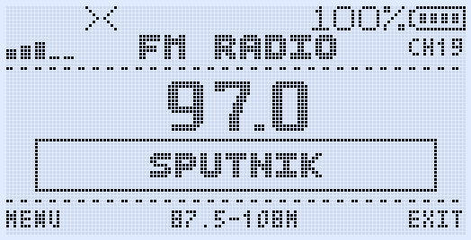 | 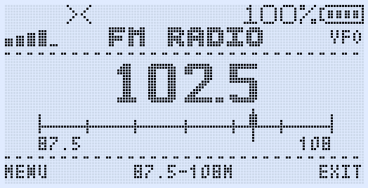 |

### Search Frequency and Search Tone

Open **Search Frequency** with **F + 4**, or **Search Tone** with **F + STAR**. Both screens use the same header, status, frequency/tone rows and footer controls as the other Messenger tools.

Install the release's `Search.app` to use these shortcuts. Search v1.5 uses the
corrected append-only overlay API, follows the displayed Full Watch A/B/C/D
channel after watch rotations, and centres the status, frequency and tone rows
between the dotted separators.

After a result is found, press **MENU / SAVE**, choose a destination memory with **UP/DOWN** or the number keys, then press **MENU** and confirm `SAVE?`. Empty targets are marked `CH-xxxx`; occupied targets show the channel number and name, shortened with `..` when necessary. A saved result opens directly in MR mode without also opening the main menu.

Scanner-created memories preserve the power setting that was active before the search, use **NARROW** bandwidth, and store airband results as **AM** rather than FM.

| Frequency discovery | Tone identification |
| --- | --- |
| 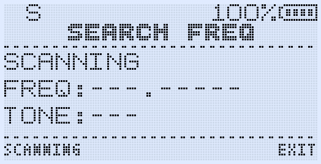 | 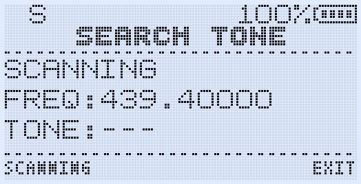 |

### Overlay apps

KLEANFW provides 48 external-Flash app slots. Empty slots are hidden; hold UP/DOWN to move quickly through the list and press `*` to toggle the right column between app size and version. Install `.app` files from the **Apps** page in Armel's UV Studio while the radio is running normally.

The firmware exposes F4HWN's append-only official ABI 1 / API 4 contract
(memory-channel access/staging, app TX power and the GPS-position service
slot), as in GOGUFW 3.6.x. GOGUFW-only services use `APP_CAP_GOGU_EXT` and a
separately versioned extension table. Binaries from the old experimental
GOGUFW API 4–9 layout are not compatible. Official API-3 apps work when their
declared resident capabilities are available; Beam remains unsupported.

### Channel policies and main-screen indicators

- **No FSK TX** blocks Messenger and Range Check transmission on an individual memory channel while leaving ordinary voice TX and FSK reception available.
- **No Roger** suppresses the selected Roger beep or MDC tail on an individual memory channel.
- The radio-wave icon indicates that FSK TX is permitted on that memory channel.
- The musical-note icon indicates that the global Roger/MDC selection is active and permitted on that memory channel.

These settings appear as normal memory-list columns and under **Properties → Extra** in the custom CHIRP module.

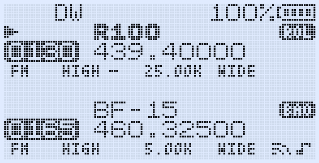

### Spectrum

Open Spectrum with **F + 5**.

- **MR mode** sweeps the channels of the active scan list (ScList, or the last
  list chosen during a scan); excluded channels are skipped. The top-left label
  shows the list and the channel count (`ALL 42`, `RPT 12`), and **4** moves to
  the next list. The bottom labels show the first and last position inside the
  list (`M:1` … `M:<n>`).
- **VFO mode** scans a continuous range with 16 to 2048 samples. Higher values
  combine several RF samples into each of the 128 display columns, with a
  simplified ruler from 512x upward.
- The peak frequency, modulation and listen bandwidth are shown on the top line
  in both modes.
- **PTT** stops on a peak and listens. **MENU** while listening adjusts the
  LNA/PGA gains (restored on exit). **6** switches the listen bandwidth
  25k / 12.5k / 6.25k at once; in MR it stays for every channel until EXIT or
  a long MENU.
- **PTT** again opens the saved MR channel that matches the peak, or lands in
  the VFO like a typed frequency. It does not transmit.
- **SIDE1** ignores the current peak until Spectrum is closed (nothing is
  saved). **SIDE2** runs the F+8 backlight cycle (always on → always off →
  `BLTime`). The backlight otherwise follows `BLTime`.
- **UP/DOWN** resumes scanning, **EXIT** returns.

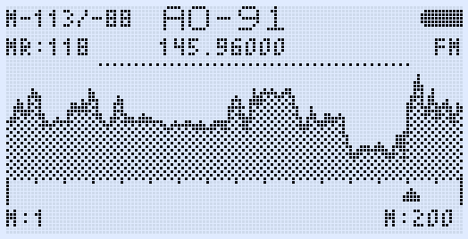

### Multiboot

Hold **MENU while powering on** to open the firmware-slot selector.

- On first use, the firmware creates a one-time backup of the Main firmware in slot 0. Do not interrupt `Init Main`.
- Slot images are completely CRC-checked before internal Flash is erased.
- Each slot uses a private settings bank by default, including Messenger settings/drafts, CryKey and FM station names.
- `SetCfg` can deliberately pair a slot with a compatible settings bank.
- Calibration and the boot logo remain shared.
- KLEANFW can run as Main or from a slot and uses the official F4HWN multiboot image format.

## Quick shortcuts

| Function | Shortcut |
| --- | --- |
| Messenger | **F + MENU** |
| HEARD / Range Check | **F + 7** |
| CALLTX | **F + 9** |
| Broadcast FM | **F + 0**; requires both `FMVFO.app` and `FMMemory.app` |
| Search Frequency | **F + 4**; requires `Search.app` |
| Search Tone | **F + STAR**; requires `Search.app` |
| Spectrum | **F + 5** |
| Backlight override cycle | **F + 8**: always on → always off → saved strategy |
| Keypad lock | Hold **F** |
| Change scan list while scanning | **F + UP/DOWN** or two number keys |
| Exclude channel/frequency while scanning | Hold **MENU** |
| Multiboot | Hold **MENU** while powering on |

## CHIRP

Use the module that matches the firmware release. For KLEANFW 0.1.0:

1. Start CHIRP and choose **File → Load Module**.
2. Select `KLEANFW_0.1.0_chirp_module.py`.
3. Download the radio using **Quansheng → UV-K1 / UV-K5 V3 KLEANFW**.
4. Edit channels, side-key actions, Messenger/Call settings, CryKey, F Lock,
   FM names, `No FSK TX`, `No Roger`, `Scrambler` (fixed carriers and HOP)
   and `Compander` as required.
5. Upload the completed image to the radio.

The firmware and module support the radio's 1024 memory-channel layout. Only
the module for the current firmware is kept in this repository; GOGUFW modules
and modules of other releases are not compatible and can overwrite newer
fields. The CHIRP module is licensed under the GNU GPL v2 or later (see
[LICENSE-GPL-2.0.txt](LICENSE-GPL-2.0.txt)), not under the Apache License.

## Build from source

The release images are built with Docker:

```bash
./compile-with-docker.sh   # firmware only
./build-all.sh             # firmware, every overlay app and the CHIRP module check
```

Without Docker, the Fusion preset requires CMake, Ninja and the ARM GNU
Embedded toolchain (`arm-none-eabi-gcc`):

```bash
cmake --preset Fusion --fresh
cmake --build --preset Fusion
```

The build emits `build/Fusion/kleanfw.bin` and the multiboot file name
`f4hwn.kleanfw.v0.1.0.bin`. The image must not exceed 120,832 bytes;
`build-all.sh` checks it and collects everything in `build/dist/`. See
`BUILD_VSCODE_MAC.md` or `BUILD_WITH_VSCODE.md` for environment setup.

## Credits and license

KLEANFW is not a clean-room firmware. It is a modified version of GOGUFW, which
builds on several generations of Quansheng community work. The attribution
below describes the parts that directly reached this project or served as a
documented design reference.

| Project / contributor | Contribution used by KLEANFW |
| --- | --- |
| [Gogu-Qs / GOGUFW](https://github.com/Gogu-Qs/GOGUFW-UV-K1-Messenger) | The direct base of KLEANFW (GOGUFW 3.6.2): Messenger, HEARD, multi-radio Range Check, wake/ACK/PONG reliability work, the CALLTX feature and melodies, FM names and Live RSSI, channel policies, the fixed per-channel scrambler integration, UI adaptations and CHIRP integration. CALLTX uses the inherited low-level tone/TX audio path, but its feature design, melodies, selection/preview behavior and user interface are GOGUFW work. RF Log Lite was inspired by Armel's RF Log and independently reimplemented as a smaller 20-entry RAM-only version for GOGUFW. |
| [Dual Tachyon](https://github.com/DualTachyon/uv-k5-firmware) | Original open UV-K5 firmware foundation, hardware drivers and AirCopy/FSK plumbing that the Messenger RF layer adapts on the BK4829 platform. |
| [OneOfEleven](https://github.com/OneOfEleven/uv-k5-firmware-custom) | Core custom-radio work inherited through the firmware lineage, including the AM-fix, scrambler and low-level radio foundations. |
| [fagci](https://github.com/fagci/uv-k5-firmware-fagci-mod) | Original Spectrum Analyzer implementation inherited and further adapted through egzumer, F4HWN, GOGUFW and KLEANFW. |
| [egzumer](https://github.com/egzumer/uv-k5-firmware-custom) | The custom-firmware base that brought together the OneOfEleven modifications, fagci Spectrum and the broader extended radio feature set. |
| [Armel / F4HWN](https://github.com/armel/uv-k1-k5v3-firmware-custom) | The Fusion base of GOGUFW, including the UV-K1/UV-K5 V3 integration, radio/UI improvements, menu categories, Action Picker, official multiboot implementation, overlay app ABI and UV Studio, and the original RF Log feature. |
| [muzkr](https://github.com/muzkr/uv-k1-k5v3-firmware-custom) | Joint UV-K1/UV-K5 V3 PY32F071 port, board support, drivers and external SPI-flash/settings work used by the current platform. |
| [mrkusypl](https://github.com/mrkusypl/uv-k1-k5v3-firmware-custom) and [Tunas1337](https://github.com/Tunas1337) | Upstream optimization, FM/UI/Spectrum and hardware-support work incorporated through the F4HWN base. |
| [joaquimorg](https://github.com/joaquimorg/UV-KX-firmware) and [Kamil / NUNU](https://github.com/kamilsss655/uv-k5-firmware-custom) | Earlier UV-K5 radio-to-radio Messenger work that helped establish the feature and provided comparison material. NUNU's manual Spectrum behavior also served as a reference while correcting GOGUFW's manual mode. |
| [Jacek Lipkowski SQ5BPF](https://github.com/sq5bpf/uvk5-reverse-engineering), EGZUMER, JOC2 and F4HWN | The Quansheng UV-K5 CHIRP driver and its adaptations, from which the KLEANFW CHIRP module is derived. |
| [AislanJefferson](https://github.com/AislanJefferson) | KLEANFW: HOP voice scrambler, CryKey and encrypted Messenger text, Spectrum rework, flash-wear reduction, F Lock BRASIL, menu-category integration, the fixes listed in the CHANGELOG and the user manual. |

GOGUFW also thanks [lohtse](https://github.com/lohtse),
[mkalin22](https://github.com/mkalin22), Konstantin Leibovitch and
[Robby69](https://github.com/robby69), as well as the other community members
who supplied reproducible real-radio reports, build-configuration feedback and
regression testing for Messenger, Range Check, Spectrum, FM and radio safety.

**Licenses.** The firmware is distributed under the
[Apache License 2.0](LICENSE). Copyright and license headers already present in
individual source files remain in force; files changed by KLEANFW carry a
"Modified by AislanJefferson for KLEANFW" notice and files added by KLEANFW
carry their own header. The [NOTICE](NOTICE) file must be kept with any
redistribution. The CHIRP module (`KLEANFW_*_chirp_module.py`) is licensed
under the GNU GPL v2 or later ([LICENSE-GPL-2.0.txt](LICENSE-GPL-2.0.txt)).
Bundled third-party components keep their own licenses: Arm CMSIS
(Apache-2.0), CherryUSB (Apache-2.0) and mpaland's embedded printf (MIT).

## Legal notices

- **No warranty.** KLEANFW is provided "AS IS", without warranties or
  conditions of any kind, and the authors are not liable for any damage
  (Apache License 2.0, sections 7 and 8). Flashing custom firmware can brick
  the radio or erase its calibration. Back up the radio and its calibration
  first, and keep a DFU recovery image.
- **No affiliation.** KLEANFW is an independent project, not affiliated with,
  sponsored by or endorsed by Gogu-Qs, Armel / F4HWN, Quansheng or any other
  project named here. Quansheng, UV-K1 and UV-K5 are trademarks of their
  owners; GOGUFW is the name of the Gogu-Qs project. These names are used only
  to describe the code's origin and the supported hardware.
- **Radio regulations.** You are responsible for complying with the licensing,
  frequency, power, emission and equipment-certification rules of your
  country. Modified firmware can void the type approval (for example Anatel
  homologation) of the radio. `F Lock = UNLOCK ALL` allows TX outside the
  frequencies you may be authorised to use.
- **Scrambler and encryption.** Transmissions encoded to obscure their meaning
  are prohibited in the amateur service (ITU Radio Regulations, Article 25.2A;
  for example FCC 47 CFR §97.113(a)(4) in the USA) and restricted on many other
  services. Use the scrambler, HOP and CryKey only where they are allowed.
  None of them provides security: HOP is a hopping spectrum inversion, and
  the Messenger encryption has no authentication.
- **Cryptography.** The firmware contains cryptographic software (XTEA). Check
  the laws of your country on using, importing and exporting it.
